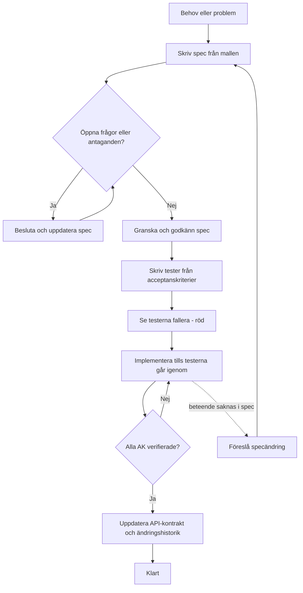

# Arbetssätt: spec-driven development

Varje funktion eller ändring börjar med en spec utifrån [mallen](specs/_mall.md). Testerna skrivs från acceptanskriterierna och koden skrivs sist. Se [teststrategi](teststrategi.md) för testnivåer.

